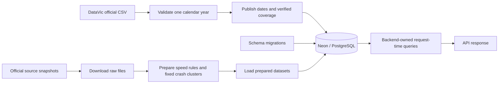

# Code responsibilities — iteration3_v1

The Git deliverable prepares and loads reusable datasets. It contains download,
build, migration, load and disposable-database capacity measurement stages.
Backend developers own request validation, queries and API responses using those
loaded datasets. Local reference query implementations are excluded from Git.

English module and function docstrings explain inputs, outputs, errors and side
effects directly in the committed Python files. Migration SQL comments explain
the stored contract. See [README.md](README.md) for setup and commands,
[data_model.md](data_model.md) for the database model, and
[backend_handover.md](backend_handover.md) for the contract a backend must implement.

## Where the pipeline ends



The pipeline endpoint is a validated, loaded dataset in PostgreSQL. Capacity
measurement is an additional pipeline diagnostic in a disposable database.
Accepting a user's location, time or date range and constructing a response is
backend work. The handover documents the stored data and required behavior;
this Git deliverable does not provide a backend query library or query CLI.

## Offline data pipeline code

Package modules live under `src/iteration3_v1_pipeline/`; deployment wrappers
live under `deploy/`. The links below resolve from this document's directory.

| File | Responsibility | Input → output |
| --- | --- | --- |
| [download.py](src/iteration3_v1_pipeline/download.py) | Obtain the published speed datasets | CKAN resource metadata and GeoJSON downloads → raw zone/sign files and source metadata |
| [crash_download.py](src/iteration3_v1_pipeline/crash_download.py) | Obtain official crash and location snapshots | Published CSV resources → raw crash/location files and provenance |
| [calendar_download.py](src/iteration3_v1_pipeline/calendar_download.py) | Discover and download the official DataVic CSV; offline imports require a source-check timestamp | DataVic CSV → immutable snapshot with acquisition/verification metadata and hashes |
| [calendar.py](src/iteration3_v1_pipeline/calendar.py) | Validate annual DataVic school-term and public-holiday data, recording regional coverage limitations | Saved CSV snapshot → calendar CSV, source manifest, validation report and optional local-build diff |
| [calendar_review.py](src/iteration3_v1_pipeline/calendar_review.py) | Validate recorded human corrections and their supported date interval | Original snapshot + corrected CSV + review/evidence record → reproducible schema-4 full-year or bounded calendar bundle |
| [calendar_storage.py](src/iteration3_v1_pipeline/calendar_storage.py) | Verify candidate artifacts, compare against the DB and publish one year | Matching CSV/manifest → dry-run report or atomic period/coverage update with an expected-version check |
| [deploy/github_actions.py](deploy/github_actions.py) | Retain the historical all-dataset deployment interface and its tests; not called by the current workflow | Historical complete artifact → independent stage results; this path does not implement the new annual/history publication gates |
| [build.py](src/iteration3_v1_pipeline/build.py) | Prepare statewide speed data and match sign evidence | Raw zones/signs → `road_speed.csv`, `speed_rule.csv`, `report.json` |
| [legacy.py](src/iteration3_v1_pipeline/legacy.py) | Preserve the earlier static-speed extraction rules locally | Source features → accepted road records and EWKT; no import from another iteration |
| [signs.py](src/iteration3_v1_pipeline/signs.py) | Parse sign validity, orientation and time windows during preparation | Source sign properties → normalized `Rule` records for the build |
| [crash.py](src/iteration3_v1_pipeline/crash.py) | Select the crash cohort, assign seasonal periods and build fixed clusters | Raw crashes and location labels → event/hotspot CSVs and a build manifest |
| [load.py](src/iteration3_v1_pipeline/load.py) | Apply all migrations and load roads/rules independently of calendars | Prepared speed CSVs → `road_speed` and `speed_rule`; `apply_migration` creates all nine tables |
| [crash_storage.py](src/iteration3_v1_pipeline/crash_storage.py) | Validate/load one crash build and measure its storage in a disposable database | Matching CSVs/manifest → three crash tables; optional capacity report |
| [001_schema.sql](postgresql/migrations/001_schema.sql) | Define speed storage, constraints, indexes and geometry normalization | DDL → three speed tables and a geometry write trigger |
| [002_crash.sql](postgresql/migrations/002_crash.sql) | Define storage for the prepared crash build | DDL → `crash_build`, `hotspot`, `crash_event` and query-supporting indexes |
| [004_calendar_coverage.sql](postgresql/migrations/004_calendar_coverage.sql) | Define verified calendar-year metadata | DDL → `calendar_coverage`; does not register old calendar rows as verified or grant backend permissions |
| [005_report_email_dispatch.sql](postgresql/migrations/005_report_email_dispatch.sql) | Define the backend-owned report delivery state | DDL → `report_email_dispatch`; does not send email or grant runtime permissions |
| [backup.py](deploy/backup.py) | Save and verify all nine tables; rehearse restore only in a disposable database | Private custom-format archive and manifest; preserves both application email histories |
| [operations.py](deploy/operations.py), [operations_policy.py](src/iteration3_v1_pipeline/operations_policy.py) | Prepare immutable candidates, gate reviewed publication and report read-only status | Source snapshots and policy → exact candidate ID; explicit publication uses the existing loaders |
| [workflow_support.py](deploy/workflow_support.py) | Verify GitHub provenance, archive candidates and retain/reconcile publication evidence | Workflow inputs and authenticated GitHub metadata → verified artifacts, release archives and resolved publication history; no DB connection |
| [operations.json](config/operations.json) | Centralise annual crash dates and operational review thresholds | Versioned settings used by candidate preparation and publication |

## Read the maintenance flow in this order

The supported operational entry point is
[the workflow](../../.github/workflows/iteration3-v1-neon.yml). The package CLI
still exposes individual build/load commands, but those low-level commands do
not provide the complete review, archival and annual-publication protocol.

| Stage | Function or job to read | Contract and effect |
| --- | --- | --- |
| Schedule | `workflow_support.scheduled_candidates` and `dispatch_candidates` | Dispatch separate `main` preparation runs. No database secret or publication is involved. |
| Prepare | `operations.prepare` | Obtain only the selected domain's sources, build under a temporary directory, validate the result and retain a new immutable candidate directory. Failure keeps a separate actionable report. |
| Inspect | `operations.validate_candidate`, `_summary` and `_quality` | Check the exact candidate identity, complete file inventory, domain contracts and operational completeness. File consistency does not replace a human source review. |
| Verify provenance | `workflow_support.verify_source` / `verify_source_documents` | Check repository, workflow, successful run, `main`, attempt, artifact and producer commit before treating a downloaded artifact as publishable. |
| Preserve evidence | `archive_candidate`, `publication_history`, `begin_publication` | Complete and verify the candidate archive; reject unresolved earlier publications; retain a draft intent before providing the writer connection. |
| Publish | `operations.publish`, `_publication_gate`, existing domain loader | Revalidate a private copy, serialize cooperative writers, inspect current DB state, enforce annual/count/restore gates and load only the chosen domain. |
| Record result | `record_publication` / `reconcile_publication` | Finalize acknowledged outcomes. Uncertain writes retain a draft; reconciliation records reviewed human DB evidence without connecting to the DB itself. |
| Monitor | `operations.status` | Read coverage, storage and active crash period with read-only transaction defaults; write a local report and request attention when needed. |
| Recover all tables | `backup.backup`, `verify`, `restore` | Save all nine tables with PostgreSQL tools. Local verification needs no DB; the built-in restore command accepts only explicitly confirmed disposable databases. |

### Candidate identity and publication identity

`candidate_manifest.json` binds the selected dataset, period, source commit,
preparation/check times, counts, quality result, producer policy/lockfile and
every retained file's hash and size. `candidate_id` hashes the manifest without
its own ID field. A calendar/crash `build_id` instead identifies that domain's
prepared data contract. A new check can produce a different candidate identity
even if its prepared build is unchanged; do not use these identifiers
interchangeably. Neither identifier alone proves a successful publication.

The candidate directory contains `raw/`, `payload/` and `producer/`. Raw source
bytes remain available for investigation; payload files are the loader's input;
producer files explain how the candidate was prepared. Publication uses the
current trusted implementation and current quality policy. It never imports or
executes code from an archived candidate or installs that candidate's lockfile.

`publish` copies and revalidates the candidate before database access, then loads
that private copy. This prevents a local edit while waiting for a writer lock
from changing the reviewed bytes. The operational session lock coordinates
publishers using that protocol. The domain loader uses its own transaction; it
does not make the DB commit and GitHub evidence upload one atomic operation.
The retained intent and explicit reconciliation procedure handle that gap.

### Calendar review and runtime coverage

`calendar_review.build_reviewed_calendar` reads a saved official snapshot,
corrected CSV and `review.json`. It retains the originals, checks their hashes,
records exact row changes and validates official evidence metadata. It does not
browse the evidence pages or decide their truth for the operator. The reviewed
build retains four school terms and all required confirmed holiday families;
only the documented unresolved AFL case may be deferred beyond the supported
period. No guessed holiday is inserted.

`calendar.validate_bundle` dispatches schema 3 to the established official-CSV
contract and schema 4 to `validate_reviewed_bundle`. The latter reconstructs the
expected result from the retained originals, correction and review, then checks
the complete bundle. A matching hash alone cannot excuse a changed review or
contradictory source record.

`calendar_storage.load_calendar` publishes one year's periods and coverage
together. A bounded candidate may retain known rows outside its supported date
range; those rows do not extend `coverage_start` / `coverage_end`. The loader
exposes the bounds in dry-run and requires an explicit bounded-backend assertion
for writes. The backend must independently check those dates when evaluating a
calendar-dependent rule. The assertion flag neither deploys nor inspects it.

### Where to change operational policy

Use [operations.json](config/operations.json) and the field reference in the
[maintenance guide](docs/maintenance.md#operating-policy-fields). `read_policy`
loads trusted repository configuration; it is not a general-purpose validator
for arbitrary user settings. `baseline_range` keeps the accepted historical
range fixed. `annual_range` produces an explicit candidate range only after its
September release becomes due. Neither function changes the active DB period.

The scheduler and supported candidate-format checks also encode the agreed
September/2027/five-year contract. Changing that contract requires a reviewed
code/config/workflow/test change, not only editing a JSON value. Threshold
changes likewise affect publication of already prepared candidates because
the current policy is rechecked before loading.

## Dataset and backend boundaries

Speed rule extraction happens during preparation, while the backend decides
whether a stored rule is active at a requested time. Likewise, crash cohort
selection, seasonal classification and DBSCAN membership are calculated during
the build. Filtering those stored events for a user's area and time period is
backend work. Queries must preserve the stored DBSCAN membership and count
actual matching event points rather than whole clusters.

Speed loads replace the two road/rule tables, crash loads replace their three
tables, and calendar loads replace one year of periods plus its coverage record.
Each runs in a separate transaction, preserving the other domains and calendar
years. Calendar publication checks the expected current build ID under a year
lock. File generation and database loading are separate stages: generating a
candidate does not change Neon.

The backend checks supported coverage dates and regional limitations for the rule
evaluation date, including the previous year for an overnight window starting on
December 31. It must read matching periods and coverage from the same snapshot;
any future cache must replace both together. The reviewed `Backen_I2_V2` consumer
reads a fresh repeatable-read snapshot for each analysis request. It owns unknown
results and request-time evaluation. An administrator separately grants the
runtime role `SELECT` on the existing coverage table; migrations do not grant it.

## Local-only reference code

| Ignored local path | Responsibility outside the Git deliverable |
| --- | --- |
| `src/iteration3_v1_pipeline/lookup.py` | Local speed-query reference: request validation, candidate selection, time/calendar evaluation and response construction |
| `src/iteration3_v1_pipeline/crash_lookup.py` | Local crash-query reference: area/date/time filtering, aggregation and response construction |
| `postgresql/queries/` | Local request-time SQL, including `nearest_speed.sql` |

These files may remain in the developer's working directory but are ignored and
absent from a clean checkout. The committed CLI and selected pipeline tests do
not depend on them. `lookup` and `crash-lookup` are not supported pipeline
commands. The backend implements its own queries, rule evaluation, HTTP routes,
authentication, deployment and connection management.

Migration files under `postgresql/migrations/` remain part of the deliverable.
They create the storage schema; they do not install the local query files as
stored procedures.

## Pipeline entry point and supporting modules

| File | Pipeline responsibility |
| --- | --- |
| [__main__.py](src/iteration3_v1_pipeline/__main__.py) | Dispatches one selected speed, calendar or crash download/build/load command, migration, or `crash-measure` |
| [settings.py](src/iteration3_v1_pipeline/settings.py) | Defines iteration-owned paths and direction constants used by preparation |
| [__init__.py](src/iteration3_v1_pipeline/__init__.py) | Package documentation and identity; it performs no pipeline or request processing |

Source files do not run in filename order. The CLI calls one stage per command.
Download supplies raw inputs, build creates prepared files, migration prepares
the schema, and load replaces the corresponding dataset. Migration must finish
before load; it can run independently of download and build.

## Notification storage versus notification behavior

[003_notification.sql](postgresql/migrations/003_notification.sql) sits at the
schema boundary. The pipeline creates the table so `iteration2_v2` has a complete
nine-table schema. It neither generates notification rows from the datasets nor
calls a delivery provider.

The application owns `(trip_id,event_id)` registration, duplicate handling,
delivery and `pending` / `sent` / `failed` transitions. The actual adapter is in
the separate workspace file
`backend/US2.3-Permitted-Area-Breach-Backend/app/repository.py`. That file is
backend code, not part of this iteration's pipeline. Updating the local adapter
does not redeploy a running service. The migration also does not copy old
notification history or grant runtime-role permissions; see the
[notification cutover procedure](backend_handover.md#switching-the-notification-backend).

[005_report_email_dispatch.sql](postgresql/migrations/005_report_email_dispatch.sql)
separately defines report delivery state. The backend supplies its request hash,
digest, uppercase status and Unix-seconds timestamp. Migrations and reference-data
loaders preserve this history as well as `notification_event`; retries and any
retention policy belong to the backend. See the [support runbook](docs/operations.md)
and [maintenance guide](docs/maintenance.md) for ownership and recovery.

## Tests, configuration and generated files

| Files | Purpose |
| --- | --- |
| [test_build.py](tests/test_build.py), [test_crash.py](tests/test_crash.py) | Verify offline transformations with synthetic inputs |
| [test_calendar.py](tests/test_calendar.py), [test_calendar_download.py](tests/test_calendar_download.py), [test_calendar_cli.py](tests/test_calendar_cli.py) | Verify saved-source parsing, validation, snapshot acquisition and CLI dispatch without publishing data |
| [test_calendar_postgis.py](tests/test_calendar_postgis.py) | Verify year publication, expected-version checks, rollback and preservation in a disposable database |
| [test_notification_postgis.py](tests/test_notification_postgis.py) | Verify nine-table DDL, both email-history contracts and preservation, and speed/crash replacement rollback; no real notifications are sent |
| [test_backup.py](tests/test_backup.py) | Verify archive integrity, private credential handling and production restore rejection with mocked PostgreSQL clients |
| [test_operations.py](tests/test_operations.py) | Verify independent candidates, exact bytes, annual/catch-up/restore gates, durable-history requirements, failure reporting and disposable-DB publication |
| [test_calendar_review.py](tests/test_calendar_review.py) | Verify correction evidence, deferred AFL bounds, bundle regeneration and tamper rejection without a DB |
| [test_workflow_support.py](tests/test_workflow_support.py) | Verify scheduling, GitHub provenance, archive extraction and publication-intent/reconciliation behavior with mocked GitHub calls |
| [test_deployment.py](tests/test_deployment.py) | Retain tests for the historical all-dataset helper; its synthetic source fixtures also support the new operations tests |
| [requirements.txt](requirements.txt), [requirements.lock](requirements.lock) | Declare dependencies and record the versions used for the saved validation |
| [calendar.csv](../../archive/iteration2_v2/reference/calendar.csv), [calendar_sources.json](../../archive/iteration2_v2/reference/calendar_sources.json) | Preserve historical 2026 dates and provenance; normal `load` no longer reads them |
| `data/raw/`, `data/processed/`, `reports/` | Hold source snapshots, prepared artifacts and audit records; these are data/evidence rather than application code |
| `.gitignore` | Excludes local environments, raw/processed data, Japanese documentation copies and the local reference-query files/tests from Git |

From the iteration directory, run only the committed test modules:

```bash
PYTHONPATH=src:tests python -m unittest \
  test_build test_crash test_calendar test_calendar_download test_calendar_cli \
  test_calendar_postgis test_notification_postgis test_deployment test_operations \
  test_calendar_review test_backup test_workflow_support -v
```

`test_calendar_postgis`, `test_notification_postgis` and the database test class
in `test_operations` require
`ITERATION2_TEST_DATABASE_URL` for a disposable database whose name starts with
`iteration2_test`; otherwise database tests are skipped. They recreate the
`iteration2_v2` schema.

Before the calendar pipeline was added, a temporary snapshot filtered by Git's
file selection, with the six local-only paths absent, discovered 36 tests: 32 passed and four notification database
tests were skipped. No database operations were performed in that historical check; those counts
do not describe the expanded calendar test selection.

The local-only `tests/test_lookup.py`, `tests/test_postgis.py` and
`tests/test_crash_postgis.py` are excluded from Git along with their query
dependencies. Wildcard discovery still finds them when they remain locally,
so use the explicit command above. The excluded PostGIS suites also check
storage constraints, loader rollback and input integrity. The committed notification
suite now checks failed speed/crash replacement rollback and preservation of both
email tables; it does not reinstate the excluded backend reference-query suites.

Saved reports describing 58, 77 or 81 passing tests and request-query measurements
refer to the earlier, broader local suite. They remain historical evidence and
must not be represented as results for the current committed test selection or
for the backend's own implementation.

Generated CSV/JSON files are kept in their required formats rather than having
code comments inserted into them. The definitions of their fields and their
processing rules are documented in the producing modules and the data model.
