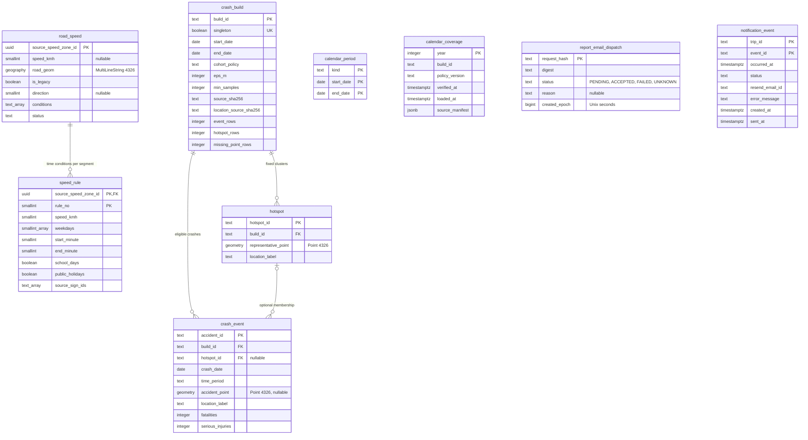

# Data Model — iteration3_v1

`iteration3_v1` is the code release name. Its database contract remains the
existing `iteration2_v2` schema; this rename adds no tables or data migration.

`iteration2_v2` consists of nine tables: two for roads/rules, two for calendars, three for crashes, one for notifications, and one for report email dispatch. The `migrate` command creates all nine tables. There are no foreign keys between the speed, crash, notification, and report email dispatch domains. Tables from the previous iteration are not runtime dependencies of this model.

This document describes the stored data and its interpretation. Request-time searches, aggregation, and API responses are implemented by the backend team; they are not provided by this pipeline package.

Existing standard speed limits and additional road segments are combined in this version's `road_speed` table. No runtime JOIN to the previous version's `road_speed` is required.

All tables in the diagram belong to the `iteration2_v2` schema; the diagram shows their main columns. The authoritative, complete definitions are [001_schema.sql](postgresql/migrations/001_schema.sql), [002_crash.sql](postgresql/migrations/002_crash.sql), [003_notification.sql](postgresql/migrations/003_notification.sql), [004_calendar_coverage.sql](postgresql/migrations/004_calendar_coverage.sql), and [005_report_email_dispatch.sql](postgresql/migrations/005_report_email_dispatch.sql).

The saved [PostGIS test record](../../archive/iteration2_v2/reports/notification_validation.json) verified the previous seven-table schema and notification preservation. The [notification deployment record](../../archive/iteration2_v2/reports/neon_notification_migration.json) describes the 2026-09-12 Neon change. Those historical records cover the original seven tables. The [2026-09-16 calendar migration record](../../archive/iteration2_v2/reports/neon_calendar_migration.json) separately confirms that the eighth table, `calendar_coverage`, was created on Neon and the backend role received `SELECT` without write privileges on it. The original tables were preserved, including the 27 calendar periods. The new table has 0 rows: schema deployment has not published or inferred coverage for any year.

## Road, Rule and Calendar Tables

| Table | Meaning of one row and main constraints |
| --- | --- |
| `road_speed` | One segment from the official Speed Zone dataset. Its UUID does not identify an entire physical road. `speed_kmh` holds the standard speed limit or an evidence-supported speed limit outside scheduled hours; it is `NULL` when unconfirmed. |
| `speed_rule` | One weekday and time condition that applies to a segment. The segment UUID and `rule_no` form the composite primary key. |
| `calendar_period` | One date interval, inclusive at both ends. The composite primary key consists of `kind`, the start date, and the end date. It has no foreign key and is consulted when evaluating rules. |
| `calendar_coverage` | One calendar publication per year key. Inclusive coverage bounds and source scope are in its manifest; schema-4 reviewed coverage may be shorter than a year. Regional completeness remains false. Stores the version, policy, verification/load timestamps and source manifest; the loader updates it with period rows in one transaction. |

`road_speed.status` is the stored classification: `static`, `scheduled`, `dynamic`, or `unresolved`. It describes the build result, not whether a rule is active at a requested time; the backend evaluates that separately. Rows with `is_legacy=true` come from the existing standard speed extraction and retain their speed limit and `static` status. There are no LGA classification columns or tables.

Roads are stored as WGS84 `geography(MultiLineString,4326)` and queried through a GiST index. Writes apply the same transformation to EPSG:7899 and 1 m geometry simplification as the previous version.

Weekdays use ISO numbering, from Monday 1 to Sunday 7. Times are minutes in Melbourne local time. Start values range from 0 to 1439, and end values from 0 to 1440, where 1440 means 24:00. Intervals include the start and exclude the end; a start greater than the end denotes an interval crossing midnight. `source_sign_ids` contains the official sign IDs supporting the rule; it is not a foreign key to a sign table.

Calendar `kind` values are `SCHOOL_TERM`, `PUBLIC_HOLIDAY`, and `REGIONAL_HOLIDAY_UNCERTAIN`. The CSV-only 2026 build contains four school terms, 13 public-holiday dates and one Melbourne Cup uncertainty date. It does not load the historical reference snapshot's nine other regional dates. Local substitute and part-day holidays published separately by Business Victoria are not collected or manually supplemented. School terms retain the government term-start policy; Cup remains uncertain across the state because local boundaries are not represented. Calendar-dependent results in affected local areas may therefore be incomplete. The calendar is independent of the historical crash dataset.

`calendar_coverage` records the following publication metadata:

| Column | Meaning |
| --- | --- |
| `year` | Primary key for the publication; consult manifest bounds to determine supported dates |
| `build_id` | Published calendar artifact version for this year |
| `policy_version` | Version of the interpretation policy, including term starts and regional uncertainty |
| `verified_at` | Time when the official information underlying this build was verified |
| `loaded_at` | Time when this version was published to the database |
| `source_manifest` | JSONB evidence: source URL/hash, output hash/counts, policy/status, inclusive coverage bounds, source scope and regional limitations. Reviewed schema 4 also retains original/corrected/review file hashes, reviewer, row changes, completeness attestation and unconfirmed events. |

Coverage is not derived from the dates of the first/last period rows. The backend must recognize the manifest policy/status and check its evaluation date against inclusive `coverage_start` / `coverage_end`. A missing year or out-of-range date remains unknown. An overnight rule uses its start date, so a January 1 request may need the previous year's December 31. Read period rows and coverage in one consistent snapshot and cache together by year/build ID. Verification describes information checked at that timestamp; later announcements may require a new build. Identical schema-3 content reuses its original `verified_at`, even if another snapshot records a later check. Track that later check separately.

The original schema-3 policy `victoria-datavic-csv-only-v3` remains full-year `READY`, with scope `datavic_school_terms_and_public_holidays`. Reviewed schema 4 uses policy `victoria-reviewed-calendar-v4`, scope `reviewed_victoria_school_terms_and_public_holidays`, and `verified_at` from the explicit operator review. A full-year review is `READY`; shorter coverage is `READY_BOUNDED`, `full_year_complete: false`, `requires_bounded_backend: true`. `coverage_complete: true` attests completeness only for the stated interval and scope. Known period rows outside that interval may be retained, but they provide no coverage. Both policies retain `regional_holidays_complete: false` and do not add local/part-day holiday support.

Reviewed bundles retain the untouched official CSV and its manifest under `original/`, the corrected CSV under `reviewed/`, and `review.json`. Hashes, explicit evidence/reviewer/reason and exact row changes identify the derivation; corrected input is never described as an unmodified official download. Validation reconstructs the manifest and output from those files. Review schema and backend requirements are specified in [backend_handover.md](backend_handover.md#reviewed-corrections-and-bounded-calendar-coverage). No new database table or column is introduced.

`calendar_period` keeps its three-column schema and has no year column. `calendar-load` validates that all candidate periods stay within the declared year, rejects existing cross-year intervals, and publishes that year's rows together with coverage. Migration infers no coverage from historical data. Ordinary builds reject missing/unconfirmed required dates. Reviewed builds retain all other annual completeness checks and may explicitly defer only an unconfirmed AFL holiday whose evidence-supported lower bound is after the coverage end. Missing dates inside the interval remain invalid. Bounded publication is blocked unless the caller explicitly opts in after verifying a compatible backend; dry-run remains available. The repository supplies the contract, not the backend implementation. Regional information outside source scope remains a documented limitation.

## Three Crash Tables

| Table | Meaning of one row and main constraints |
| --- | --- |
| `crash_build` | One set of inputs, date range, classification, and clustering parameters. The unique constraint on `singleton=true` permits only one active build. |
| `hotspot` | One DBSCAN cluster fixed across the full date range. Its representative point and display label are selected from actual member crashes. |
| `crash_event` | One official crash meeting the cohort criteria. The official `ACCIDENT_NO` is stored uniquely as `accident_id`. |

The cohort filter is `YOUNG_DRIVER_18_25 > 0 AND INJ_OR_FATAL > 0`, and the default date range is 2021-01-01 through 2025-12-31. `fatalities` and `serious_injuries` count people of all ages involved in each crash. Crash counts are derived from row counts, not from differences between casualty counts. Individual person records and breakdowns by speed range or crash type are not stored.

`crash_build` also records `region=Victoria`, `eps_m=100`, `min_samples=3`, `crs_epsg=3111`, the time classification and clustering policy versions, SHA-256 hashes of both inputs, record counts, and the load time. The build ID is derived from the inputs and generation parameters.

Clustering uses planar coordinates in EPSG:3111; points are stored as WGS84 `geometry(Point,4326)`. The representative point is the actual coordinate of the member crash closest to the coordinate-wise median in the projected coordinate system. The 100 m setting is DBSCAN's neighborhood distance, not a maximum cluster radius.

Located crashes that do not belong to a cluster have `hotspot_id=NULL`. Crashes with missing coordinates are retained with both `accident_point=NULL` and `hotspot_id=NULL`. Neither group is deleted; the backend can expose located, unclustered crashes as individual points. A GiST index on `accident_point::geography` excludes NULL values, and a B-tree index covers `(hotspot_id,time_period)`.

When implementing circular-area crash queries, the backend must first test the actual `crash_event.accident_point` against the search circle, then aggregate by `hotspot_id`. Representative points are display locations; they do not determine whether crashes fall within the search area or how many to count. `location_label` contains road and intersecting-road names from the official Accident Location dataset, joined by accident ID. If these cannot be confirmed, the original road name or `Unknown location` is used.

## Notification Table and Data Updates

Speed loads fully replace only `road_speed` and `speed_rule` in one transaction; crash loads fully replace the three crash tables in one transaction. All crash records are loaded as a single build. A calendar load replaces just its target year in `calendar_period` and `calendar_coverage` in a separate transaction, preserving other years. Its year lock and expected-current-build-ID check prevent an update based on a stale version. All loaders preserve the other domains; a later speed load cannot restore the historical reference calendar over a newer publication.

`notification_event` tracks notification records and delivery status by `(trip_id,event_id)`. It has the same eight columns, types, defaults, and constraints as the previous version. `status` must be `pending`, `sent`, or `failed`. `occurred_at` and `created_at` are required; `sent_at` is `NULL` before delivery. The composite primary key and an INSERT that ignores conflicts prevent duplicate registration of the same event. The application is responsible for status updates. A database primary key alone does not guarantee exactly-once email delivery.

Notifications are recorded incrementally by the application and are not replaced by speed, crash or calendar loads. Reapplying migrations also preserves existing rows. Notifications are not linked to accident IDs, hotspot IDs, or speed segment UUIDs. The 200 MB capacity assessment, which excludes speed data, adds the measured size of this version's notification table when it exists.

The local notification backend code references `iteration2_v2.notification_event`. The old `iteration1_v2.notification_event` table is retained. To apply the change to the running service, stop writes to the old table, inspect and carry over existing deduplication keys, statuses, and timestamps, then redeploy the updated code. This pipeline does not copy notification history automatically. See [backend_handover.md](backend_handover.md#switching-the-notification-backend) for the procedure.
